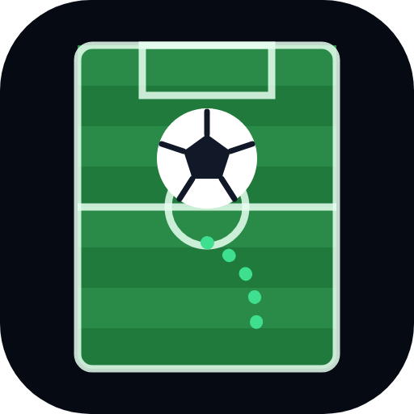

# PocketSoccer



**A soccer career for your phone, played in portrait with one thumb, right in the browser.** Create a striker, winger
or midfielder at 17, earn your minutes from the manager, chase the Golden Boot, get the big move, and play every
chance that falls to you.

**Play:** https://eddyarriaga00.github.io/pocket-soccer/ (add it to your home screen for full screen)

Sister game to [PocketFootball](https://github.com/eddyarriaga00/pocket-football). Plain JavaScript, no install, no
build step. Every club and player is fictional.

## How it plays

A match is simulated, with live commentary. When the ball finds you, the game stops on **your moment** and you play it:
a few seconds of real football around you, with teammates making runs, defenders pressing and covering, and a keeper
who dives, until it ends in a goal, a save, a miss, a lost ball, a foul or offside. Then the match carries on.

| Gesture | With the ball | Without it |
|---|---|---|
| Drag and hold | Dribble (sprint at the edge of the stick) | Run (a run forward calls for the ball) |
| Flick | Shoot at goal, pass to a teammate, or play it into space. Faster = harder | Sliding tackle |
| Bend the flick | Curl it (it still finishes where you aimed) | |
| Tap a teammate | Pass to his feet | |
| Tap inside the goal | Placed side-foot finish | |
| Tap elsewhere | Knock it ahead and burst | Call for it, or tackle |

Seven kinds of moment: the edge of the box, a run in behind (stay onside), a counter attack, down the wing, running
the midfield, free kicks with a jumping wall, and penalties. Fouls in the box chain into a penalty.

## My Career

Your rating out of 10 after every match, with the reasons listed. XP to spend on Pace, Shooting, Passing, Dribbling,
Defending and Physical. Manager trust decides whether you're on the bench, in rotation or starting. A 12-club league
over 22 matchdays, a Golden Boot race, Player of the Season, transfer offers when you outgrow your club, an age curve
that peaks in your mid-twenties, and retirement. **Quick Moments** is an endless practice mode.

## Docs

- [docs/PLAN.md](docs/PLAN.md): the design (pillars, controls, moments, career systems, milestones)
- [docs/RESEARCH.md](docs/RESEARCH.md): the research behind it, with sources
- [docs/ROADMAP.md](docs/ROADMAP.md): status, how to test, rollback points

## Run it locally

```
python3 tools/serve.py 48241
```

then open http://localhost:48241 (or just open `index.html`). `tools/harness.js` plays hundreds of moments and whole
seasons for balance testing (see the roadmap).

## Layout

```
index.html          the page
css/game.css        the look
js/data.js          clubs, names, nations, positions, commentary
js/physics.js       the pitch and the ball (drag, curl, bounce, goal frame)
js/moment.js        a live moment: players, AI, controls, camera, drawing
js/sim.js           the simulated match, moments, ratings
js/career.js        the career model and save
js/ui.js            the screens
tools/              local server and test harness
```
